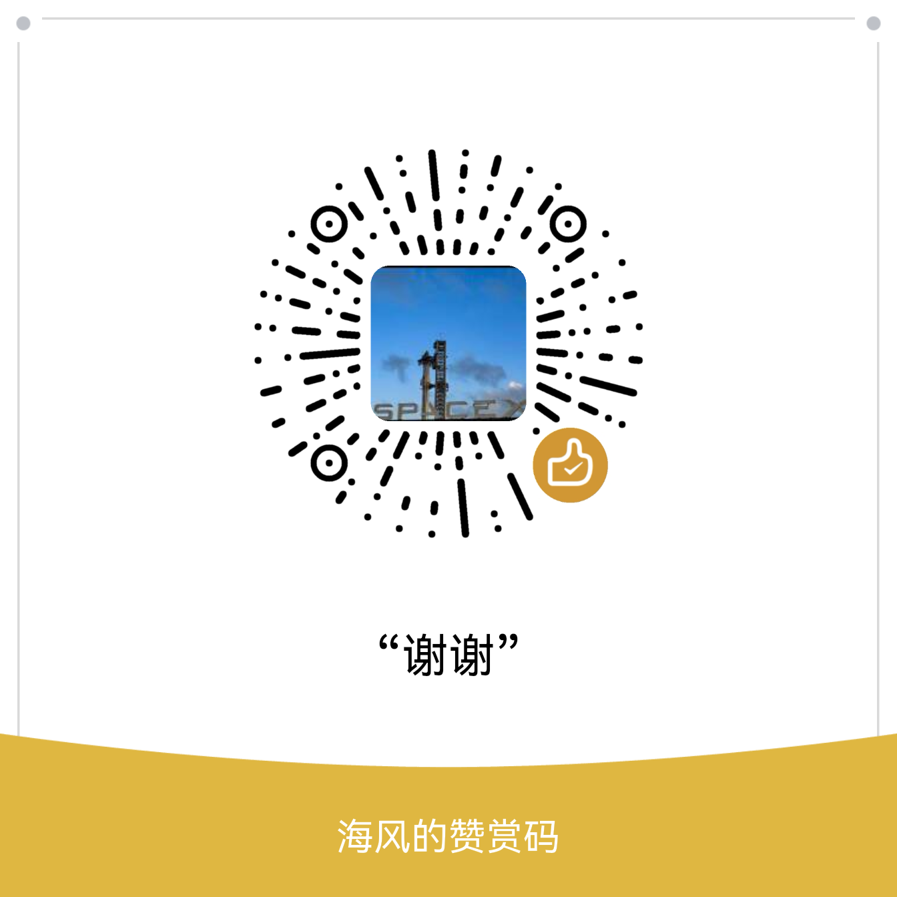

<div align="center">


<h1>IPTV 外壳</h1>

<p><a href="https://kele551.github.io/iptv-shell/"></a></p>

<p><b>先拿东西</b>：<a href="https://kele551.github.io/iptv-shell/download/iptv-shell-Windows.zip"><b>⬇ 免安装包 · Windows（8.4 MB，这台电脑不用装 Python）</b></a><br>
备用下载：<a href="https://github.com/kele551/iptv-shell/releases/download/v1.0/iptv-shell-Windows.zip">GitHub Release 同一份文件</a>　|　<a href="https://github.com/kele551/iptv-shell/archive/refs/heads/main.zip">源码 zip（这条路要 Python 3.9+）</a></p>

<p><b>第一次来，先打开官网</b>：<a href="https://kele551.github.io/iptv-shell/">https://kele551.github.io/iptv-shell/</a><br>
官网有截图、安装方式，还能一键复制「给智能体的一句话」，比在 README 里翻更快。</p>

<a href="https://github.com/kele551/iptv-shell/releases/latest" title="下载量 · 实时"></a>
<a href="https://hits.sh/github.com/kele551/iptv-shell/" title="浏览量 · 实时"></a>

<a href="https://github.com/kele551/iptv-shell/blob/main/LICENSE"></a>


<a href="https://github.com/kele551/iptv-shell/stargazers"></a>
<a href="https://github.com/kele551/iptv-shell/network/members"></a>
<a href="https://github.com/kele551"></a>


<a href="https://github.com/kele551/iptv-shell"></a>
<a href="https://github.com/kele551/iptv-shell"></a>
<a href="https://kele551.github.io/iptv-shell/"></a>
<a href="https://github.com/kele551/iptv-shell/issues"></a>
<a href="#sponsor"></a>

<p>📺 <b>IPTV 外壳</b>　·　本机直播台表 + 三色节目单 + 点播海报墙，播放交给本机播放器</p>

<p>作者 <b>海风（kele551）</b>　·　<a href="https://github.com/kele551/iptv-shell">GitHub</a>　·　<a href="https://kele551.github.io/iptv-shell/">官网</a></p>
</div>

# IPTV 外壳模板（通用版）

一个只在本机跑的小服务：**直播列表 + 节目单三色 + 点播海报墙 + 详情卡 + 一键交本机播放器**。
界面是现成的，线路数据从 `providers/` 里取 —— **换线路只换一个文件，不改界面、不改服务。**

默认端口 **8905**。**下载页面上的免安装包，双击 `IPTV-Shell.exe` 就能跑，这台电脑不用装 Python**；只有走源码那条路才需要 Python 3.9 以上（纯标准库，不用装任何依赖）。播放要用本机已装的播放器，mpv / VLC / PotPlayer 任一，没装时网页会提示。

---

## 用之前先确认：这个外壳不带源

它只负责「把一份已经能用的线路装进好看的界面」，**不提供任何直播源或点播源**。

| 你的情况 | 能不能用 |
|---|---|
| 家里已经开通 IPTV，盒子/电视上本来就能看 | **能用**：把这条线路抓成本机清单接进来 |
| 手上已有能用的 m3u / xmltv（自己整理的、公开合法的、别人给的） | **能用**：改两行配置就接上 |
| 宽带没开通 IPTV，手上也没有任何清单 | **用不了**：装上也是空壳，台表空、点播页签点进去是空态 |

一句话：**先有源，再用外壳。** 没有源不是「没配好」，是真的没东西可播 —— 这种情况先别装。

---

## 复制这一句给你的智能体

打开智能体对话框，整段粘过去就行（不用改字）：

```
请帮我把这个 IPTV 外壳装到你这台电脑上，再接上这台电脑所在的网络。

第 0 步先拿东西：如果这台电脑上已经有 IPTV 外壳的项目目录，就直接用；没有就从 https://kele551.github.io/iptv-shell/download/iptv-shell-Windows.zip 下载免安装包（这个地址连不上就换 https://github.com/kele551/iptv-shell/releases/download/v1.0/iptv-shell-Windows.zip），解压到 D:\Program Files\IPTV外壳（没有就新建这个目录；别解压到桌面，桌面只留图标），会得到一个 IPTV-Shell 文件夹，里面的 IPTV-Shell.exe 双击就能跑，这台电脑不用装 Python。

然后按这个顺序做：跑 IPTV-Shell.exe probe（这个 exe 没有控制台窗口，结果会写到同一个文件夹里的 命令行输出.txt，等它自己跑完再读那个文件），把本机正在跑的服务、磁盘里的 m3u / m3u8 / xmltv 清单、已有的 IPTV 项目都列出来；选一份能用的接进外壳（改 IPTV-Shell 文件夹里的 config.json，或照 _internal\providers\转发示例.py 写一个适配器）；跑 IPTV-Shell.exe check（同样等它跑完、看 命令行输出.txt），出「可以交」才算接好。装好以后桌面会自动出现一个「IPTV外壳」图标，以后双击那个图标就能看（文件夹本身别放桌面）。

播放只用这台电脑上装好的播放器（mpv / VLC / PotPlayer 任一），不要内嵌网页播放器，也不要开机自启。要是这台宽带没开通 IPTV、探路也找不到任何清单，就直接告诉我「这条网络没有可用源」，别编假数据、别拿演示数据糊弄我。

不要把步骤列给我，你自己在这台电脑上执行。最后把 check 的原始输出贴给我，不要只说「成功了」；没通过就说清哪一项没过、卡在哪。
```

---

## 智能体要照这个顺序做

0. **先确认东西在哪** —— 用户机器上有没有这个目录。没有就下免安装包（见上面「先拿东西」）解压到 D:\Program Files\IPTV外壳（没有就新建），桌面只留图标，**别反问用户要地址、别自己编一个下载地址**；
1. `IPTV-Shell.exe probe`（源码态是 `python tools\探路.py`）—— 本机在跑的服务、磁盘上的 m3u/xmltv、旧 IPTV 项目一次列全（**先自己找，别反问用户要地址**）；
2. 有清单：`config.json` 填 `provider: "m3u"` + `m3u_path`（直播）+ `vod_m3u`（点播），不写代码；有服务：照 `providers\转发示例.py` 转发；
3. `IPTV-Shell.exe check`（源码态是 `python tools\模板快检.py --provider <线路>`）必须出「可以交」，把原始输出贴给用户；
4. 装到本机：免安装包本身就是绿色的 —— 把 `IPTV-Shell` 文件夹放到**非 C 盘的目录**（如 `D:\软件\IPTV外壳`），**别放桌面**；桌面只要一个图标（第一次双击 exe 时外壳自己会放）。源码态才需要 `powershell -File tools\安装.ps1`。装完必须自己点开确认台表能出来、点开能播。

**播放只交本机播放器**（mpv / VLC / PotPlayer，外壳自己找），不内嵌网页播放器、不自己解码、不做开机自启。真的一份清单都没有，才问盒子型号和是不是运营商 IPTV —— 更细的写法看 `智能体接入指南.md`。

---

## 拿到手之后三步就用起来

1. **有现成 m3u 清单的（大多数情况）**
   打开 `config.json`，填这几行（`vod_m3u` 是可选的，填了点播就有内容）：
   ```json
   "provider": "m3u",
   "m3u_path": "F:\\我的\\直播清单.m3u",
   "xmltv_path": "F:\\我的\\节目单.xml",
   "vod_m3u": "F:\\我的\\点播清单.m3u"
   ```
   `xmltv_path` 没有就留空，界面显示「暂无节目单」，不影响观看；
   `vod_m3u` 没有就留空，**点播页签照样在，进去显示空态提示**（`data\sample-vod.m3u` 是现成样板：每条 `#EXTINF` 标题当片名、`group-title` 当分类）。

2. **想先看界面长什么样**
   ```powershell
   python server.py --provider mock
   ```
   演示线路内置 24 个台、96 部假片，不连外网也能点开节目单、海报墙、详情卡。

3. **线路要自己签名 / 自己建片库**
   照 `providers/转发示例.py` 写一个适配器（把外面的服务当数据源转发进来），
   细节看 `智能体接入指南.md`。

---

## 装到本地（Windows）

**路线 A：免安装包（推荐，机器上不用装 Python）**

1. 下载 `iptv-shell-Windows.zip`（上面「先拿东西」里两个地址任选一个）；
2. 解压到 D:\Program Files\IPTV外壳（没有就新建），桌面只留图标 → 得到一个 `IPTV-Shell` 文件夹；
3. **双击 `IPTV-Shell.exe`** → 静默起服务，自动打开浏览器，直接就是台表；**同时桌面出现「IPTV外壳」图标**，以后点图标就能看。文件夹留在非 C 盘，不占开机自启。

**路线 B：源码（要 Python 3.9+）**

1. **双击 `tools\安装.vbs`** → 桌面出现「IPTV外壳」图标；
2. **双击桌面图标** 才开始运行 → 静默起服务，约 3 秒弹出 Edge 应用窗口，直接就是台表。

**不占开机自启**：开机什么都不起，只有你点图标（或双击 exe）才起服务；关掉窗口服务仍在，再点一次立刻回来。
撤掉：删掉桌面图标和那个 `IPTV-Shell` 文件夹即可（只删程序，不动你的片源和配置）。源码态可用 `powershell -File tools\安装.ps1 -Uninstall`。

想手动管服务（不用界面）：`tools\常驻.ps1 start / stop / restart / status`；
想让它掉了自动拉起：`tools\常驻.ps1 watch`（前台守护，手动开）。

---

## 文件都是干什么的

| 文件 | 作用 |
|---|---|
| `server.py` | 服务本体：路由、缓存、后台刷新、MPV、页面渲染。**一般不用改** |
| `config.json` | 端口、标题、选哪条线路、MPV 路径、m3u/xmltv 文件位置 |
| `web/index.html` | 网页外壳（直播/点播/节目单/详情卡），标题里 `__TITLE__` `__SUB__` 由服务替换 |
| `providers/mock.py` | 演示线路：假数据，用来看界面 |
| `providers/m3u.py` | 万能线路：吃 m3u + xmltv 文件，任何线路都能接 |
| `providers/mock.py` | 演示线路：24 台、96 部假片，不连外网 |
| `providers/转发示例.py` | 示例：把已经跑通的外部服务当数据源转发进来 |
| `providers/_空模板.py` | 写新适配器的样板，复制改名就能开始 |
| `tools/模板快检.py` | 一条命令自检：起服务、打全部接口、报结论 |
| `tools/探路.py` | **接手第一步**：在本机找现成的服务 / m3u / 已有 IPTV 项目 |
| `tools/启动外壳.ps1` | 静默起服务 + 用 Edge 应用窗口打开界面 |
| `tools/常驻.ps1` | 手动管服务：start / stop / restart / status / watch（掉了自动拉起） |
| `tools/安装.ps1` / `安装.vbs` | 装桌面图标、一键卸载（**不做开机自启**） |
| `tools/外壳.vbs` | 双击就是「起服务 + 开界面」（桌面图标指向它） |
| `智能体接入指南.md` | 给智能体看的：数据契约、最少要写什么、怎么自检 |

---

## 播放：一律交给用户本机播放器

- 外壳**不内嵌播放器、不自己解码**；点「播放」只把地址交给**用户本机已装的播放器**。
- 自动按顺序找：`config.json` 的 `"mpv"` 列表 → PATH 里的 `mpv` / `vlc` → 常见安装位置
  （`VLC`、`PotPlayer`、`%LOCALAPPDATA%\Programs\mpv`）。**mpv / Yaoplayer / VLC / PotPlayer 都能播**，不用非装 mpv。
- 一个都没找到 → 网页直说「没找到本机播放器」并告诉你装 mpv 或 VLC，绝不假装能播。
- 为什么不内嵌：运营商流靠自己发 Range 才拉得动 4K，网页播放器既卡又不合规；交给本机专业播放器是唯一正路。

---

## 换一家宽带还能用吗

**模板不认宽带品牌，只认数据流。** 能不能播取决于这份源是不是「他自己那条宽带」能用的：

| 手上的源 | 结果 | 说明 |
|---|---|---|
| 他自己家宽带抓的源（哪家都一样，各抓各的） | **能** | 界面、节目单、点播、交给播放器，体验完全一样 |
| 别人家宽带的源（不在你家网络里的） | **不能** | 签出地址绑当时出口 IP + 授权限本户，换网络打开就 403；界面能显示台名，但一点播放就失败 |
| 公开互联网上的公开 m3u（非内网） | **都能** | 本来就放公网，任何宽带都播得动，`provider: "m3u"` 填路径即可 |

**不是自家宽带的话，难在抓源，不难在模板**：
- 各家的盒子、门户、鉴权都不一样，一家的抓源脚本拿到另一家的盒子上跑不通，得按他家的盒子重新抓；
- 有的地区走**组播**，电脑要能进光猫的电视口/VLAN 才抓得到；有的地区是独立拨号给电视；
- 抓不到也能接：让用户导出盒子里的 m3u，或在自己网络里取一份清单，丢进 `data\` 再 `探路 --roots`。

**当场判断能不能用（别猜）**：`python tools\探路.py` → 接上找到的清单 → `模板快检` 结论「可以交」→ 点开一个台看有没有画面。
出画面＝他这条网络认这份源；出不来＝源绑了别的网络或别的账号。

---

## 别人也能看（同一局域网）

服务监听 `0.0.0.0`，同一宽带下手机/平板/电视盒子打开
`http://<这台电脑的局域网IP>:8905/` 就能用；播放器也能直接吃 `http://<IP>:8905/live.m3u`。

**跨网络不行**：运营商地址绑出口 IP + 授权限本户，硬转出去既播不了也不合规。

---

## 给播放器用的地址

| 地址 | 内容 |
|---|---|
| `/` | 网页外壳 |
| `/live.m3u` | 直播清单（带 group-title、当前节目） |
| `/epg.xml` | XMLTV 节目单（Kodi / TiviMate / IPTVnator 都能吃） |
| `/vod.m3u` | 点播清单 |
| `/api/meta` | 线路自述：能力、标题、端口 |
| `/status` | 健康状态（部署脚本靠它判断起没起来） |

---

## 一条命令自检

```powershell
python tools\模板快检.py --provider m3u
```
它会自己起一个临时端口、把所有接口打一遍、打印 PASS/FAIL，跑完自动收拾。

## 常驻与启动方式

**打开才运行**：双击桌面图标才起服务，关掉窗口服务还在，再点一次窗口就回来；**不做开机自启**，也不往启动文件夹里放任何东西。
换端口：`python server.py --port 8906`；也可以改 `config.json` 的 `port`。

---

## 合规声明（请先读再装）

- 本项目**只是一个本机播放界面**，不含任何直播源、点播源、账号或凭据；仓库里的 `data\sample.m3u`、`data\sample-vod.m3u` 都是**虚构演示数据**（假台名、地址指向 `127.0.0.1:9`）。
- 请只接入**你自己已订购、仅限本户使用**的线路；运营商协议通常禁止解析地址和跨户共享，**这是你和运营商之间的事，本项目不鼓励也不协助**。
- **不要把源地址公开分享、不要架设对外服务、不要用于传播未授权内容**。本机自用没问题；对外提供视听服务需要相应许可。
- 本项目不采集任何用户数据，不转发他人流量，不内嵌网页播放器，不做账号共享或异地转发。
- 使用本项目产生的一切后果由使用者自负；作者不对第三方源的内容与合法性作任何担保。

---

<a id="sponsor"></a>

## 支持项目

如果 **IPTV 外壳** 帮你把台表和点播收拾利索了，**给仓库点个 Star ⭐** 就是最好的支持 —— 它能让更多人看到这个项目。

想再进一步，请作者喝杯咖啡（**完全自愿，不影响任何功能**）：

<p align="center">
  
  <br>
  <sub>微信扫一扫 · 金额随缘</sub>
</p>

> 本项目以 MIT 协议自由开源，**没有付费版、也没有付费功能**；捐赠纯属自愿，
> 与功能开放、版本更新、Issue 响应**没有任何关系**。

---

## 许可

MIT，见 `LICENSE`。


